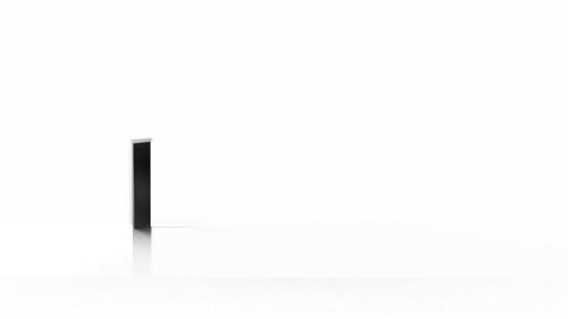

/*
NAMA   : Christian Junior Panjaitan
NIM    : 41426027
PRODI  : D4 Teknologi Rekayasa Perangkat Lunak
*/

1. TUJUAN
Saya melanjutkan halaman dari Minggu 6 Sesi 2 dengan menambahkan gambar responsif, ukuran teks yang mengalir (fluid), container query, dan dukungan reduced motion. Data yang dipakai fiktif. Hasil yang saya targetkan di Sesi 3:
- memasang foto sendiri yang menyusut dengan rasio tetap dan memakai srcset serta sizes agar browser memilih ukuran yang sesuai,
- membuat ukuran judul yang mengalir dengan clamp(),
- membedakan media query (acuan viewport) dan container query (acuan pembungkus card),
- menghormati preferensi reduced motion,
- menguji gambar, teks, dan layout pada ukuran kecil, zoom, dan keyboard.

2. CARA MENJALANKAN
1. Buka folder pswi-week-06/sesi-03 di VS Code.
2. Klik kanan index.html lalu pilih Open with Live Server.
3. Halaman terbuka lewat alamat server lokal (contoh: http://127.0.0.1:5500/). Tekan F12 untuk membuka DevTools, lalu Ctrl+Shift+M untuk mode responsif.

Susunan folder:

```
pswi-week-06/
  sesi-03/
    index.html
    style.css
    main.js
    assets/
      foto-320.jpg
      foto-640.jpg
    README.md
    bukti/
```

Foto saya simpan di folder assets supaya rapi. File main.js berisi skrip tombol salam dari Minggu 2 dan tidak saya ubah.

3. PERSIAPAN
Sebelum saya mulai, saya membuat folder baru pswi-week-06/sesi-03, lalu menyalin hasil Sesi 2 (index.html, style.css, dan main.js) ke dalamnya tanpa mengubah folder sesi-02. Setelah itu saya membuat README.md, folder bukti, dan folder assets, menjalankan server lokal seperti di Minggu 1, lalu memeriksa Git dengan git --version dan git status. Hasilnya muncul versi Git  dan git status berjalan tanpa error, jadi repository sudah ada dan saya tidak menjalankan git init lagi.

4. GAMBAR FLEKSIBEL
Saya mengganti gambar profil yang tadinya dari sumber luar dengan foto sendiri, lalu memastikan aturan ini ada di style.css:

```
img { max-width: 100%; height: auto; }
```

Foto saya buat dengan memotong foto asli menjadi rasio 16:9 memakai editor gambar, lalu mengecilkannya menjadi dua ukuran, yaitu 640 x 360px (assets/foto-640.jpeg) dan 320 x 180px (assets/foto-320.jpg). Dua file itu benar-benar dibuat ulang dengan editor, bukan hanya diganti namanya.
Tag gambar sementara (sebelum srcset ditambahkan):

```

```

Langkah dan hasilnya:
1. Periksa 404: di tab Network, assets/foto-640.jpg muncul dengan status 200 (tipe jpeg), jadi path benar dan gambar tampil.
2. Sumber: diantara foto ada yang saya ambil dari pinterest dan ada yang saya ambil dan diedit sendiri.
3. width dan height: saya isi 640 dan 360 sesuai ukuran asli file, sehingga rasionya 16:9. Atribut ini memberi tahu browser rasio gambar, jadi ruang untuk gambar sudah disediakan sebelum gambar selesai dimuat dan halaman tidak melompat.
Hasil pengamatan: di lebar 320px gambar menyusut mengikuti wadah menjadi sekitar 254 x 143px (rasio tetap 16:9, karena height: auto). Di lebar 1200px gambar tampil 640 x 360px dan tidak membesar melebihi ukuran aslinya, karena max-width: 100% hanya membatasi, tidak memperbesar.

5. KANDIDAT RESOLUSI
Saya menambahkan srcset dan sizes agar browser memilih kandidat yang sesuai:

```

```

Arti sizes: mulai lebar 48rem (768px) gambar dianggap menempati sekitar 50% lebar layar, dan di bawah itu sekitar 92%. Browser mencocokkan lebar itu dengan daftar kandidat di srcset.
Saya mengaktifkan Disable cache di tab Network, mengatur Device pixel ratio ke 1 di mode responsif, lalu memuat ulang halaman di tiap lebar dan memeriksa currentSrc di Console dengan `document.querySelector("img").currentSrc`:

| Lebar | Nilai sizes | Lebar dibutuhkan | Kandidat | currentSrc |
| :--- | :--- | :--- | :--- | :--- |
| 320px | 92vw | sekitar 294px | 320w sudah cukup | .../assets/foto-320.jpg |
| 768px | 50vw | sekitar 384px | 320w kurang, dipilih 640w | .../assets/foto-640.jpg |
| 1200px | 50vw | sekitar 600px | 640w | .../assets/foto-640.jpg |

Kandidat yang benar tersedia dan dipilih browser. Kalau ukuran jendela diperbesar tanpa memuat ulang, browser tetap memakai foto-640.jpg yang sudah terunduh dan tidak turun lagi ke kandidat kecil saat jendela dikecilkan kembali. Karena itu setiap pindah ukuran saya memuat ulang halaman. Pada layar dengan Device pixel ratio 2, browser memilih foto-640.jpg di semua ukuran karena butuh piksel dua kali lebih banyak.

6. FLUID FONT DAN CONTAINER QUERY
Fluid font. Saya memakai clamp() pada judul:

```
h1 { font-size: clamp(1.75rem, 1.2rem + 2vw, 3rem); }
```

clamp(minimum, nilai ideal, maksimum): ukuran judul tidak kurang dari 1.75rem (28px), tidak lebih dari 3rem (48px), dan di antaranya mengikuti 1.2rem + 2vw. Saya mencatat font-size di tab Computed:

| Lebar tampilan | Hitungan | font-size Computed |
| :--- | :--- | :--- |
| 320px | 19,2 + 6,4 = 25,6px, di bawah minimum | 28px (batas bawah) |
| 1200px | 19,2 + 24 = 43,2px | 43,2px |
| 1440px | 19,2 + 28,8 = 48px | 48px (tepat di batas atas) |

Container query. Saya membungkus setiap card dengan div.card-wrap, lalu menambahkan aturan berikut di akhir style.css:

```
<div class="card-wrap">
  <article class="card"> ... </article>
</div>

.card-wrap { container-type: inline-size; }
@container (min-width: 30rem) {
  .card { padding: 1.5rem; }
}
```

Aturan @container saya taruh setelah aturan padding dasar .card, karena specificity-nya sama sehingga yang paling akhir yang menang. Saya menguji dengan viewport tetap 1200px:
- Container sempit: dua kolom, lebar pembungkus sekitar 359px (kurang dari 30rem = 480px), jadi query tidak aktif dan padding card tetap 16px.
- Container lebar: lewat DevTools saya ubah grid-template-columns .catalog menjadi 1fr tanpa mengubah viewport. Lebar pembungkus menjadi sekitar 734px (lebih dari 480px), query aktif, dan padding card berubah menjadi 24px.
Perbedaan kedua query: media query (@media) bereaksi pada lebar viewport, yaitu layar atau jendela, sehingga di kedua kondisi di atas hasilnya sama karena viewport sama-sama 1200px. Container query (@container) bereaksi pada lebar pembungkusnya, sehingga komponen yang sama bisa tampil berbeda tergantung ruang yang tersedia di tempatnya. Fluid font mengikuti viewport (berubah saat jendela diubah), sedangkan padding card mengikuti pembungkus (berubah saat lebar pembungkus diubah). Perubahan memang mengikuti acuan masing-masing.

7. REDUCED MOTION DAN AUDIT
Agar ada transisi yang bisa diuji, saya memberi card efek hover yang halus, lalu menyediakan pengurangan gerakannya:

```
.card { transition: transform .2s ease; }
.card:hover, .card:focus-within { transform: translateY(-4px); }

@media (prefers-reduced-motion: reduce) {
  .card { transition: none; }
}
```

Efek ini hanya hiasan: card naik 4px, sedangkan semua teks dan tautan tetap terlihat tanpa hover. Efek yang sama juga muncul saat fokus keyboard (focus-within).
Hasil pengamatan:
1. Emulasi: di DevTools saya tekan Ctrl+Shift+P, pilih Show Rendering, lalu set Emulate CSS media feature prefers-reduced-motion ke reduce. Di tab Computed, transition-duration card berubah dari 0.2s menjadi 0s, dan card langsung berpindah saat dihover tanpa animasi.
2. Keyboard dan zoom lagi: Tab melewati semua tautan dan kontrol dengan garis fokus terlihat. Pada zoom 200% (jendela 1200px, tampilan 600px) layout menjadi satu kolom, judul 31,2px (sekitar 62px di layar, lebih besar daripada 43,2px di 100%), teks terbaca, tidak ada yang terpotong, dan tidak ada scroll ke samping.
3. Informasi hanya saat hover: tidak ada. Semua teks dan tautan terlihat tanpa hover, dan satu-satunya efek hover adalah card naik.
4. Fungsi tidak hilang: dengan reduce aktif, tautan tetap bisa diklik dan isi tetap sama.
Preferensi pengguna tidak menghilangkan fungsi.

8. LATIHAN MANDIRI DAN TABEL UJI
Saya mengulang percobaan di atas sendiri dan menulis prediksi sebelum menjalankannya. Untuk data yang tidak valid, saya sengaja membuat path gambar salah (assets/foto-64.jpg), lalu mengembalikannya setelah uji.

| Kasus | Tindakan | Harapan | Hasil aktual | Status |
| :--- | :--- | :--- | :--- | :--- |
| Normal: gambar path | Buka halaman, lihat Network | Aset termuat | foto-640.jpg status 200 dan gambar tampil | Lulus |
| Normal: gambar menyusut | Lebar 320px lalu 1200px | Menyusut dengan rasio tetap | 320px: sekitar 254 x 143px, 1200px: 640 x 360px, rasio 16:9 | Lulus |
| Normal: kandidat | Muat ulang di 320, 768, 1200px dengan cache mati | Kandidat benar dipilih | foto-320.jpg, foto-640.jpg, foto-640.jpg | Lulus |
| Normal: fluid font | Lihat Computed di 320px dan 1200px | Mengikuti viewport | 28px dan 43,2px | Lulus |
| Normal: container | Ubah lebar pembungkus, viewport tetap 1200px | Query container sesuai ruang | Sempit (sekitar 359px) padding 16px, lebar (sekitar 734px) padding 24px | Lulus |
| Normal: reduced motion | Emulasi reduce, hover card | Transisi opsional berkurang | transition-duration 0s, card berpindah seketika, fungsi tetap ada | Lulus |
| Batas: clamp 1440px | Lebar 1440px | Tepat di maksimum | 48px | Lulus |
| Batas: zoom 200% | Zoom browser ke 200% di jendela 1200px | Teks tetap terbaca | Satu kolom, judul 31,2px, tidak terpotong, tanpa scroll ke samping | Lulus |
| Batas: resize tanpa reload | Kecilkan jendela tanpa memuat ulang | Prediksi: browser tetap memakai kandidat besar | Benar, currentSrc tetap foto-640.jpg. Setelah reload di 320px, menjadi foto-320.jpg | Lulus |
| Normal: keyboard | Tab dari awal halaman | Fokus terlihat | Semua tautan dan kontrol bisa dicapai berurutan, garis fokus terlihat | Lulus |
| Gagal: path gambar salah | Ubah src menjadi assets/foto-64.jpg | Prediksi: 404 dan gambar tidak tampil | Benar, Network menampilkan 404 dan yang tampil adalah teks alt. Setelah path dikembalikan, gambar tampil lagi | Awalnya gagal, setelah perbaikan lulus |
| Gagal: urutan @container | Pindahkan blok @container ke atas aturan .card dasar | Prediksi: padding tetap 16px walau pembungkus lebar | Benar, deklarasi padding 1.5rem dicoret di panel Styles karena aturan dasar ada di bawahnya. Setelah dipindah kembali ke bawah, padding menjadi 24px | Awalnya gagal, setelah perbaikan lulus |

Lulus berarti hasil nyata sama dengan harapan atau prediksi. Bagian "Batas: resize tanpa reload" memang bukan kesalahan kode, tetapi cara browser menghemat unduhan.

9. PEMERIKSAAN HTML, CSS, DAN BEFORE-AFTER
Setelah semua percobaan selesai (path gambar sudah dikembalikan dan urutan @container sudah benar), saya memeriksa HTML akhir dengan Nu HTML Checker, hasilnya "Document checking completed. No errors or warnings to show." Atribut srcset dan sizes dikenali sebagai valid.
Saya juga memeriksa style.css dengan W3C CSS Validator. Validator ini belum tentu mengenali fitur CSS yang baru seperti @container dan container-type sehingga muncul pesan untuk dua baris itu, saya catat sebagai keterbatasan alat dan saya buktikan kebenarannya lewat uji di browser (bagian 6).

| Hal yang diubah | Sebelum | Sesudah |
| :--- | :--- | :--- |
| Gambar | Gambar dari sumber luar, lebar tetap 400px | Foto sendiri, dua kandidat (320w dan 640w) dengan srcset dan sizes |
| Rasio gambar | Tanpa width dan height | width 640 dan height 360, rasio 16:9 |
| Ukuran judul | Ukuran bawaan 32px di semua lebar | clamp(): 28px sampai 48px mengikuti viewport |
| Padding card | Tetap 1rem | 1rem, berubah menjadi 1.5rem ketika pembungkus 30rem atau lebih |
| Gerakan | Belum ada transisi | Hover halus, mati otomatis saat reduced motion |

10. PERBANDINGAN DENGAN CONTOH LAMPIRAN
Setelah selesai berlatih, saya membandingkan hasil saya dengan Lampiran A1 dan A2. Perbedaannya:
- Lampiran punya breakpoint kedua (min-width: 64rem) yang membuat tiga kolom, sedangkan halaman saya hanya dua kolom, karena lebar body saya dibatasi 50rem sehingga tiga kolom tidak akan muat.
- Lampiran membatasi lebar nav, main, dan footer dengan width: min(92%, 68rem), sedangkan halaman saya memakai pembatas lebar pada body.
- Lampiran memakai a:focus-visible dengan outline 3px, sedangkan saya masih memakai garis fokus bawaan browser.
- Lampiran mematikan transition dan animation pada reduced motion, sedangkan saya hanya mematikan transition karena tidak ada animation.
- Contoh container query tidak ada di lampiran A1, jadi bagian itu saya tulis sendiri sesuai modul.
- Nilai sizes di Lampiran A2 punya tiga rentang karena gambarnya berada di grid tiga kolom, sedangkan gambar saya berada di luar grid sehingga saya memakai dua rentang dari modul. Nilainya hanya perkiraan, dan yang saya periksa adalah currentSrc-nya.
Satu keputusan yang saya pahami: memakai srcset dan sizes bersama width dan height, supaya layar kecil mengunduh gambar kecil dan halaman tidak melompat. Satu risiko yang ditangani: nilai sizes yang tidak sesuai layout bisa membuat browser memilih kandidat yang salah, dan itu saya periksa lewat currentSrc di tiga lebar.

11. GIT DAN SETORAN
Sebelum git add, saya cek perubahan dengan git status dan git diff, dan memastikan tidak ada file rahasia, data pribadi, atau file sementara yang besar. Lalu saya menjalankan:

```
git status
git diff
git add .
git commit -m "PSWI Week 6 Sesi 3: latihan dan pengujian"
git pull
git push
```

12. AI USE STATEMENT
Alat: Claude (Anthropic). Tujuan: memahami isi modul dan menyusun README. Bagian yang dibantu: susunan README, bahasa penjelasan, dan hitungan clamp serta pilihan kandidat gambar. Verifikasi: semua percobaan saya jalankan sendiri di browser dan DevTools, lalu saya cocokkan dengan tabel uji, Nu HTML Checker, dan CSS Validator. Saya tidak memasukkan data pribadi atau password ke AI dan saya bisa menjelaskan kode ini saat walkthrough.
